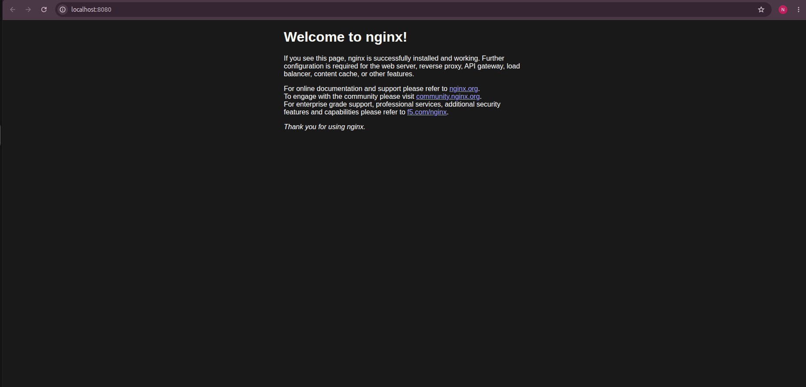
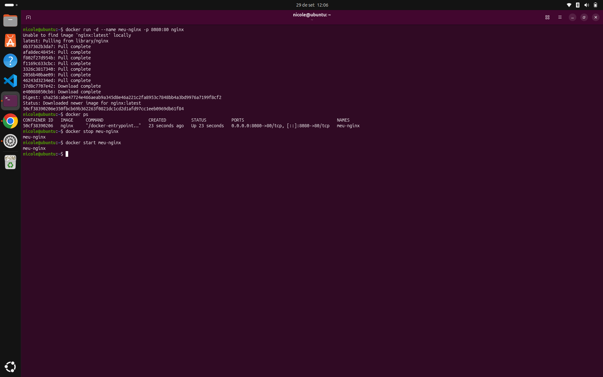

# 🐳 Docker Fundamentals

Laboratório prático dos **fundamentos do Docker no Ubuntu**: instalação, validação do ambiente e execução de um servidor web **Nginx** em container, com mapeamento de portas e gerenciamento do ciclo de vida.

## 🎯 Objetivo

Entender como o Docker executa aplicações isoladas em containers, praticando:

- validação da instalação (`docker run hello-world`)
- download e execução de imagens do Docker Hub
- execução em segundo plano e mapeamento de portas (`-d`, `-p`)
- listagem, parada e reinício de containers (`docker ps`, `stop`, `start`)

## 🧰 Ambiente

- Ubuntu 26.04 LTS (amd64)
- Docker Engine (<!-- ex: instalado pelo repositório oficial da Docker via apt -->)
- Imagens: `hello-world` e `nginx` (Docker Hub)

## 🧠 Conceitos básicos

| Conceito | Descrição |
|----------|-----------|
| **Imagem** | pacote somente leitura com a aplicação e suas dependências (ex.: `nginx`) |
| **Container** | instância em execução de uma imagem, isolada do resto do sistema |
| **Docker daemon** | serviço que cria e gerencia containers |
| **Docker Hub** | registro público de onde as imagens são baixadas |
| **Porta mapeada** | liga uma porta do host a uma porta do container (`host:container`) |

## 🛠️ Passo a passo

### 1. Validar a instalação

```bash
docker run hello-world
```

Como a imagem não existia localmente, o Docker a baixou do Docker Hub, criou um container e o executou. A mensagem de saída confirma o fluxo completo:

```text
cliente Docker → daemon → pull da imagem (Docker Hub) → container criado → saída exibida
```

### 2. Executar o Nginx

```bash
docker run -d --name meu-nginx -p 8080:80 nginx
```

| Parâmetro | Descrição |
|-----------|-----------|
| `-d` | executa o container em segundo plano |
| `--name meu-nginx` | define o nome do container |
| `-p 8080:80` | mapeia a porta **8080 do host** para a **80 do container** |
| `nginx` | imagem usada para executar o servidor web |

### 3. Acessar pelo navegador

Abrir [http://localhost:8080](http://localhost:8080). A página padrão do Nginx foi exibida:



O acesso funciona porque o tráfego da porta 8080 do host é encaminhado para a porta 80 dentro do container.

### 4. Gerenciar o container

```bash
docker ps                # lista os containers em execução
docker stop meu-nginx    # para o container
docker start meu-nginx   # inicia novamente o mesmo container
```

| Comando | Efeito |
|---------|--------|
| `docker ps` | mostra ID, imagem, status, portas e nome dos containers **em execução** |
| `docker stop` | encerra o container de forma ordenada |
| `docker start` | reinicia o container já criado, sem criar outro |



## 🔍 Troubleshooting

Perguntas que este laboratório já permite responder:

| Pergunta | Comando | Onde olhar |
|----------|---------|-----------|
| O Docker está funcionando? | `docker run hello-world` | mensagem de confirmação |
| O container está rodando? | `docker ps` | coluna `STATUS` |
| Em qual porta ele responde? | `docker ps` | coluna `PORTS` (`0.0.0.0:8080->80/tcp`) |
| A página abre? | navegador em `localhost:8080` | página padrão do Nginx |

## 🧠 Aprendizados

- Uma **imagem** é o modelo, e o **container** é a instância em execução dele.
- O Docker baixa a imagem automaticamente do Docker Hub se ela não existir localmente.
- Sem `-p`, o container não fica acessível pelo host: o mapeamento de portas é o que expõe o serviço.
- `-d` libera o terminal, e `docker ps` é o primeiro comando para ver o que está rodando.
- `stop` e `start` controlam o ciclo de vida do **mesmo** container.
- Containers conectam conceitos de Linux (processos, redes e isolamento) à entrega de aplicações.

