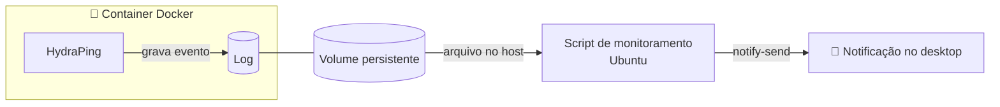
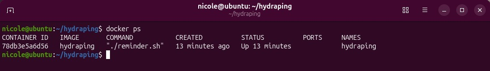

# 💧 HydraPing

Lembrete de hidratação que roda em **container Docker**, registra eventos em **logs persistentes** e dispara **notificações no desktop Ubuntu**, com intervalo configurável.

> **Destaque:** a primeira abordagem foi bloqueada pelo **AppArmor**. Em vez de desabilitar a proteção, redesenhei a arquitetura para que o container nunca precise acessar o sistema de notificações do host.

## 🎯 Objetivo

Criar um pequeno serviço que:

- execute dentro de um container Docker
- registre os lembretes em logs
- mantenha os logs persistentes (volume)
- gere uma notificação no desktop Ubuntu
- permita configurar o intervalo entre os lembretes

## 🧰 Tecnologias

| Área | Ferramentas |
|------|-------------|
| Containers | Docker, Dockerfile, volumes, variáveis de ambiente |
| Linux | Ubuntu, Bash, D-Bus, `notify-send` |
| Segurança | AppArmor |
| Observabilidade | logs em arquivo |

## 🏗️ Arquitetura



| Componente | Responsabilidade |
|------------|------------------|
| **Docker** | executa o HydraPing e gera os eventos |
| **Volume** | mantém os logs fora do container, persistentes |
| **Log** | registra cada lembrete |
| **Script no Ubuntu** | monitora o log |
| **`notify-send`** | exibe a notificação no desktop |

## 🔐 O desafio: AppArmor

### Primeira abordagem

O container tentava acessar diretamente o sistema de notificações do host via **D-Bus**. O AppArmor bloqueou:

```text
GDBus.Error:org.freedesktop.DBus.Error.AccessDenied
An AppArmor policy prevents this sender from sending this message
```

### Investigação

| Pergunta | Conclusão |
|----------|-----------|
| O Docker ou o Bash estavam com defeito? | Não, ambos funcionavam normalmente |
| O que estava falhando? | O container tentava acessar um recurso protegido do host |
| Quem bloqueou? | O AppArmor, aplicando sua política de segurança |
| É um bug? | Não, é o comportamento esperado de uma proteção funcionando |

### Decisão

**Não desabilitei o AppArmor.** Desligar uma proteção para fazer algo funcionar resolve o sintoma, mas enfraquece a segurança do sistema. Mudei a arquitetura para respeitar o limite entre container e host.

### Nova abordagem

O container só **gera o evento e grava no log**. Quem aciona a notificação é um script no próprio Ubuntu, que monitora esse arquivo. Assim cada parte faz uma coisa só e o container não precisa de acesso ao D-Bus do host.

## ⚖️ Decisões de design

| Decisão | Motivo |
|---------|--------|
| Container não acessa o D-Bus do host | respeita o isolamento e o AppArmor |
| Comunicação via arquivo de log | simples, observável e desacoplada |
| Log em volume | os dados sobrevivem à recriação do container |
| Notificação no host | o desktop pertence ao host, não ao container |
| Intervalo configurável | ajuste sem alterar o código |

## 🛠️ Como executar

<!-- Preencha com os comandos reais que você usou. Esqueleto: -->

```bash
# 1. Construir a imagem
docker build -t <nome-da-imagem> .

# 2. Executar o container com volume e intervalo configurável
docker run -d --name <nome-do-container> \
  -e <VARIAVEL_INTERVALO>=<segundos> \
  -v <pasta-do-host>:<pasta-no-container> \
  <nome-da-imagem>

# 3. Iniciar o script de monitoramento no Ubuntu
./<nome-do-script>.sh
```

Para acompanhar os eventos:

```bash
tail -f <caminho-do-log>
```

## 📸 Resultado

### Notificação no desktop


### Container em execução


### Logs


## 🧠 Aprendizados

- Fazer uma aplicação funcionar não significa que a primeira abordagem seja a adequada.
- Um bloqueio de segurança é uma informação: antes de contorná-lo, é preciso entender **o que** ele protege e **por quê**.
- Separar responsabilidades (gerar evento, registrar, notificar) deixou o sistema mais simples e seguro.
- Containers, sistema operacional, permissões e mecanismos como o AppArmor trabalham em camadas, e entender essa relação é parte do troubleshooting.

## 📚 O que pratiquei

| Área | Tópicos |
|------|---------|
| Docker | `Dockerfile`, build de imagens, execução de containers, variáveis de ambiente, volumes, persistência |
| Linux | Bash scripting, análise de logs, `notify-send`, D-Bus |
| Segurança | AppArmor, isolamento entre container e host |
| Método | investigação baseada em evidências e adaptação da solução sem enfraquecer a proteção |
