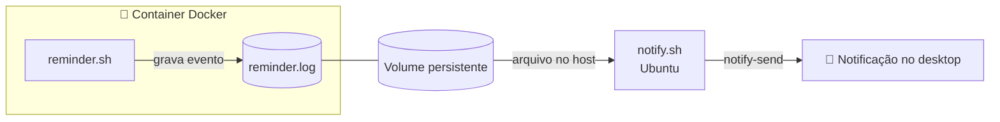

# 💧 HydraPing

Lembrete de hidratação que roda em **container Docker**, registra eventos em **logs persistentes** e dispara **notificações no desktop Ubuntu**, com intervalo configurável.

> **Destaque:** a primeira abordagem foi bloqueada pelo **AppArmor**. Em vez de desabilitar a proteção, redesenhei a arquitetura para que o container nunca precise acessar o sistema de notificações do host.

## 🎯 Objetivo

Criar um pequeno serviço que:

- execute dentro de um container Docker
- registre os lembretes em logs
- mantenha os logs persistentes (volume)
- gere uma notificação no desktop Ubuntu
- permita configurar o intervalo entre os lembretes

## 🧰 Tecnologias

| Área | Ferramentas |
|------|-------------|
| Containers | Docker, Dockerfile, volumes, variáveis de ambiente |
| Linux | Ubuntu 24.04, Bash, D-Bus, `notify-send` |
| Segurança | AppArmor |
| Observabilidade | logs em arquivo |

## 🏗️ Arquitetura



| Componente | Responsabilidade |
|------------|------------------|
| **`app/reminder.sh`** | roda no container: gera o lembrete e grava no log |
| **Volume** | mantém o log fora do container, persistente |
| **`notify.sh`** | roda no Ubuntu: monitora o log e aciona a notificação |
| **`notify-send`** | exibe a notificação no desktop |

## 🗂️ Estrutura do projeto

```text
09-hydraping/
├── app/
│   └── reminder.sh     # roda no container: gera o lembrete e grava no log
├── screenshots/        # evidências
├── notify.sh           # roda no host (Ubuntu): monitora o log e dispara a notificação
├── Dockerfile          # imagem baseada em ubuntu:24.04
├── .dockerignore
└── README.md
```

## 🔐 O desafio: AppArmor

### Primeira abordagem

O container tentava acessar diretamente o sistema de notificações do host via **D-Bus**. O AppArmor bloqueou:

```text
GDBus.Error:org.freedesktop.DBus.Error.AccessDenied
An AppArmor policy prevents this sender from sending this message
```

### Investigação

| Pergunta | Conclusão |
|----------|-----------|
| O Docker ou o Bash estavam com defeito? | Não, ambos funcionavam normalmente |
| O que estava falhando? | O container tentava acessar um recurso protegido do host |
| Quem bloqueou? | O AppArmor, aplicando sua política de segurança |
| É um bug? | Não, é o comportamento esperado de uma proteção funcionando |

### Decisão

**Não desabilitei o AppArmor.** Desligar uma proteção para fazer algo funcionar resolve o sintoma, mas enfraquece a segurança do sistema. Mudei a arquitetura para respeitar o limite entre container e host.

### Nova abordagem

O container só **gera o evento e grava no log**. Quem aciona a notificação é o `notify.sh`, que roda no próprio Ubuntu e monitora esse arquivo. Assim cada parte faz uma coisa só e o container não precisa de acesso ao D-Bus do host.

## ⚖️ Decisões de design

| Decisão | Motivo |
|---------|--------|
| Container não acessa o D-Bus do host | respeita o isolamento e o AppArmor |
| Comunicação via arquivo de log | simples, observável e desacoplada |
| Log em volume | os dados sobrevivem à recriação do container |
| Notificação no host | o desktop pertence ao host, não ao container |
| Intervalo configurável por `INTERVAL_MINUTES` | ajuste sem alterar o código nem reconstruir a imagem |

## ⚙️ Como funciona o `notify.sh`

O script roda no Ubuntu, fora do container:

1. Cria o arquivo de log (`touch`) caso ele ainda não exista.
2. Acompanha o arquivo com `tail -n 0 -F`, lendo apenas as linhas **novas**.
3. Quando uma linha contém a mensagem de lembrete, chama `notify-send` e a notificação aparece no desktop.

> ⚠️ O `notify.sh` procura o texto exato da mensagem de lembrete. Se a mensagem gravada pelo `reminder.sh` mudar, o script precisa ser atualizado.

## 🛠️ Como executar

**Pré-requisitos:** Docker e `libnotify-bin` (já vem no Ubuntu Desktop).

```bash
# 1. Criar a pasta de logs no host
mkdir -p ~/hydraping/data

# 2. Iniciar o monitor no Ubuntu (deixe rodando em um terminal)
chmod +x notify.sh
./notify.sh
```

Em **outro terminal**, na pasta do projeto:

```bash
# 3. Construir a imagem
docker build -t hydraping .

# 4. Executar o container com volume e intervalo configurável
docker run -d --name hydraping \
  -e INTERVAL_MINUTES=15 \
  -v "$HOME/hydraping/data:/data" \
  hydraping
```

### Configuração

| Item | Valor | Descrição |
|------|-------|-----------|
| `INTERVAL_MINUTES` | padrão `15` | intervalo entre lembretes, **em minutos** |
| Volume | `~/hydraping/data` → `/data` | o container grava `/data/reminder.log`, que aparece no host |

Para testar rápido, use `-e INTERVAL_MINUTES=1` (um lembrete por minuto).

> 💡 **Inicie o `notify.sh` antes do container.** Como o monitor lê só as linhas novas do log, os primeiros lembretes podem passar sem notificação se o container começar antes.

Para acompanhar os eventos:

```bash
tail -f ~/hydraping/data/reminder.log
```

Para parar e remover o container:

```bash
docker stop hydraping && docker rm hydraping
```

## 📸 Resultado

### Notificação no desktop


### Container em execução


### Logs


## 🧠 Aprendizados

- Fazer uma aplicação funcionar não significa que a primeira abordagem seja a adequada.
- Um bloqueio de segurança é uma informação: antes de contorná-lo, é preciso entender **o que** ele protege e **por quê**.
- Separar responsabilidades (gerar evento, registrar, notificar) deixou o sistema mais simples e seguro.
- Containers, sistema operacional, permissões e mecanismos como o AppArmor trabalham em camadas, e entender essa relação é parte do troubleshooting.
