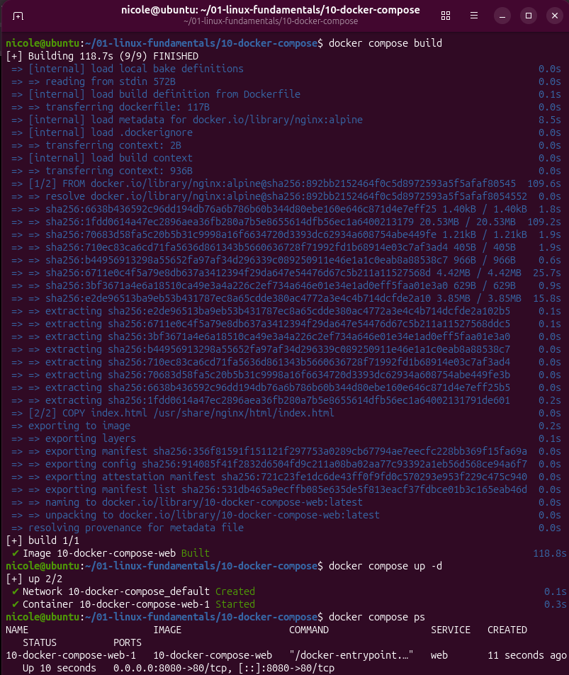

# 🐳 Docker Compose

Laboratório prático de **Docker Compose**: construção de uma imagem a partir de um `Dockerfile` e execução de um serviço **Nginx** que serve uma página HTML personalizada, tudo definido em um único arquivo `compose.yaml`.

## 🎯 Objetivo

Definir e executar uma aplicação web de forma declarativa e reproduzível, praticando:

- construção de imagem a partir de um `Dockerfile` (`docker compose build`)
- definição de serviço e mapeamento de portas no `compose.yaml`
- execução e encerramento da aplicação (`up -d`, `down`)
- verificação do estado do serviço e consulta de logs (`ps`, `logs`)

## 🧰 Ambiente

- Ubuntu Linux
- Docker Engine e Docker Compose
- Imagem base: `nginx`

## 📂 Estrutura do projeto

```text
10-docker-compose/
├── app/
│   ├── Dockerfile      # receita da imagem
│   └── index.html      # página servida pelo Nginx
├── compose.yaml        # definição do serviço
└── README.md
```

## 🧠 Conceitos básicos

| Conceito | Descrição |
|----------|-----------|
| **Dockerfile** | receita que descreve como construir uma imagem |
| **Imagem** | pacote somente leitura com a aplicação e suas dependências |
| **Container** | instância em execução de uma imagem |
| **Docker Compose** | ferramenta que define e executa serviços a partir de um arquivo YAML |
| **Serviço** | bloco do `compose.yaml` que descreve um container (imagem, portas etc.) |

## 📄 Arquivos do projeto

### `app/Dockerfile`

```dockerfile
# cole aqui o conteúdo real do seu Dockerfile
```

### `app/index.html`

```html
<!-- cole aqui o conteúdo real da sua página -->
```

### `compose.yaml`

```yaml
# cole aqui o conteúdo real do seu compose.yaml
```

## 🛠️ Passo a passo

Todos os comandos são executados na pasta que contém o `compose.yaml`.

### 1. Construir a imagem

```bash
docker compose build
```

Lê o `Dockerfile` indicado no `compose.yaml` e gera a imagem do serviço.

### 2. Iniciar a aplicação

```bash
docker compose up -d
```

Cria e inicia o container em segundo plano (`-d`), com as portas e configurações definidas no `compose.yaml`.

### 3. Acessar no navegador

Abrir [http://localhost:8080](http://localhost:8080). A página HTML personalizada é servida pelo Nginx:


### 4. Verificar o serviço

```bash
docker compose ps
```

Mostra os serviços do projeto, o estado de cada um e as portas publicadas.

### 5. Consultar os logs

```bash
docker compose logs
```

Exibe a saída dos containers. No Nginx, cada acesso à página aparece como uma linha de log.



### 6. Parar e remover

```bash
docker compose down
```

Para e remove os containers (e a rede criada pelo projeto). A imagem construída continua no disco, então um novo `up -d` é rápido.

## 🔀 Compose x `docker run`

No lab [08](../08-docker-fundamentals) o Nginx foi iniciado com um comando longo. Com o Compose, essa configuração fica em um arquivo versionado.

| | `docker run` | `docker compose` |
|---|---|---|
| Configuração | opções digitadas no comando | arquivo `compose.yaml` |
| Reprodutibilidade | depende de lembrar o comando | `docker compose up -d` repete o mesmo resultado |
| Build da imagem | comando separado (`docker build`) | integrado (`docker compose build`) |
| Vários serviços | um comando por container | todos no mesmo arquivo |
| Encerrar tudo | `stop` e `rm` por container | `docker compose down` |

## 🔍 Troubleshooting

| Pergunta | Comando | Onde olhar |
|----------|---------|-----------|
| O serviço está rodando? | `docker compose ps` | coluna de estado do serviço |
| Em qual porta responde? | `docker compose ps` | coluna de portas (`8080->...`) |
| O que o Nginx registrou? | `docker compose logs` | linhas de acesso e mensagens de erro |
| A página abre? | navegador em `localhost:8080` | página personalizada |

Fluxo usado: **build → up → verificar (`ps`, navegador) → logs → down**.

## 🧠 Aprendizados

- O `compose.yaml` documenta e reproduz a execução: quem clona o repositório sobe a aplicação com um comando.
- `build` cria a **imagem** e `up` cria o **container** a partir dela.
- O mapeamento de portas é o que expõe o serviço do container no `localhost` do host.
- `docker compose down` encerra o projeto inteiro, e não só um container.
- `ps` e `logs` são os primeiros comandos para diagnosticar um serviço.
